<!-- readme-standard: 2026-11-02 -->
<div align="center">



# 🌎 The Holy Earth Foundation — Changelog & Library

*A running, public-safe record of what's shipped across the foundation's sites, and the library behind it.*

[](LICENSE)
[](https://theholyearthfoundation.github.io/changelog-astro-public/)

[](https://code.claude.com/docs/en/overview)


 **You are here:** The Holy Earth Foundation › source `changelog-astro` (private) → twin `changelog-astro-public` (public) · `main` is the working branch

</div>

##  TL;DR

1.  **What this is.** A plain-language, dated record of what has shipped across [iamoneself.com](https://www.iamoneself.com) and David Amaringo's site, with a `/library` of deeper write-ups. This file is also the live site's homepage.
2.  **Who it is for.** Someone outside the foundation who cares about the work, not the team who already knows the context.
3.  **Do this first.** [Read the live site](https://theholyearthfoundation.github.io/changelog-astro-public/). To add an entry, create `changelog/YYYY-MM-DD-short-slug.md`.

> A running, public-safe record of what's shipped across The Holy Earth Foundation's sites — plus a
> growing library of the deeper technical write-ups behind it.


---

<strong><i class="ph ph-door-open"></i> <a href="https://theholyearthfoundation.github.io/changelog-astro-public/">Changelog &amp; Library Astro Porch →</a></strong>

<a href="https://theholyearthfoundation.github.io/"><i class="ph ph-arrow-square-out"></i> Entry portal</a> ·
<a href="https://theholyearthfoundation.github.io/changelog-astro-public/changelog"><i class="ph ph-clock-counter-clockwise"></i> Changelog</a> ·
<a href="https://theholyearthfoundation.github.io/changelog-astro-public/teachings"><i class="ph ph-flower-lotus"></i> Teachings</a> ·
<a href="https://theholyearthfoundation.github.io/changelog-astro-public/library"><i class="ph ph-books"></i> Library</a> ·
<a href="https://theholyearthfoundation.github.io/changelog-astro-public/ledger"><i class="ph ph-scroll"></i> Ledger</a> ·
<a href="https://theholyearthfoundation.github.io/changelog-astro-public/map"><i class="ph ph-map-trifold"></i> Map</a> ·
<a href="https://theholyearthfoundation.github.io/changelog-astro-public/roadmap"><i class="ph ph-path"></i> Roadmap</a> ·
<a href="https://theholyearthfoundation.github.io/changelog-astro-public/sustainability"><i class="ph ph-plant"></i> Sustainability</a> ·
<a href="https://theholyearthfoundation.github.io/donate/"><i class="ph ph-heart"></i> Donate</a>

---

## 👋 What this is

Private source for the foundation's public changelog — a plain-language, dated record of what's
shipped across [iamoneself.com](https://www.iamoneself.com) and David Amaringo's site, plus a
`/library` of deeper technical write-ups for anyone curious how it's all built. Written for someone
outside the foundation who cares about the work, not for the team who already knows the context.

This README is also rendered as the live site's own homepage.

## 🗂️ What's here

- `changelog/` — one markdown file per entry, `YYYY-MM-DD-short-slug.md`.
- `library/` — deeper, standalone technical docs that don't belong to one changelog entry.
- `teachings/` — a teacher's own material, in a room of its own (today, Kenney's Plants &
  Miracles, quoted exactly as printed). Served at `/teachings`; see `LICENSE-CONTENT` for its terms.
- `astro/` — the Astro site itself.
- `ROADMAP.md` and `SUSTAINABILITY.md` — where this is headed, and what keeps it running. Each is
  also a page on the site (`/roadmap`, `/sustainability`).
- `.github/workflows/sync-public.yml` — builds and syncs the compiled site (no source) to
  [`theholyearthfoundation/changelog-astro-public`](https://github.com/theholyearthfoundation/changelog-astro-public)
  on every push to `main`.

Built on the fleet-wide pattern documented at `my-template/changelog-template/README.md` — read
that first, it's the actual spec (frontmatter schema, the confirmed-done-goes-straight-to-changelog
convention, the org-vs-personal push-target rule).

## ✍️ Adding an entry

New file in `changelog/`, filename `YYYY-MM-DD-short-slug.md`:

```yaml
---
title: "Plain-language title"
date: "YYYY-MM-DD"
priority: "P1-high" # or P2-medium (default), P3-low
repo: "iamoneself" # which project this entry belongs to
who: "Christopher W" # first name + last initial; see PEOPLE in astro/src/lib/people.ts
---
```

If something can't be described publicly, it just doesn't get an entry — the private technical
record (each site's own pending-task and handoff docs) stays exactly where it already is.

## 💻 Local development

```sh
cd astro
npm install
npm run dev
```

##  Suggest a change

Noticed something? Members can open an [issue](https://github.com/theholyearthfoundation/changelog-astro/issues) or a pull request against `main`; the foundation's stewards read them and a person with the role merges. The source is private, so a visitor sees a 404 there. Not on GitHub? Reach the foundation through [iamoneself.com](https://www.iamoneself.com).

## 📄 License
- 💻 **Code:** MIT, see [`LICENSE`](LICENSE)
- 📝 **Written content** (docs, changelog and library prose, READMEs): CC BY-SA 4.0, see [`LICENSE-CONTENT`](LICENSE-CONTENT) (Isaiah's teaching material is carved out there)
- 🏷️ **Names, logos and marks:** not covered by either license, see [`TRADEMARKS.md`](TRADEMARKS.md)

---

*Maintained by [theholyearthfoundation](https://github.com/theholyearthfoundation) · w/ Anthropic's Claude Code CLI*

Co-Authored-By: Alfred · ClaudeCodeCLI · Anthropic [Sonnet-5]

<sub>The front door follows the living [README standard](https://github.com/drasticstatic/my-template/blob/main/README-STANDARD.md). Copy it, improve it.</sub>
